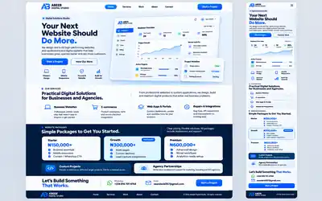

# Approved Abeeb Digital Studio homepage

This is the approved visual direction for the website redesign. Treat the image as the reference for layout, spacing, colour balance and hierarchy.

## Visual rules

- Brand palette: deep navy, royal blue, bright sky blue, white and pale blue-grey.
- The header is clean and light, with the AB mark, wordmark, restrained navigation and one primary action.
- The hero is editorial rather than poster-like: concise copy on the left, one high-quality architectural photograph on the right, and four compact capability indicators.
- Services sit on a white surface in four balanced cards. Use blue icons sparingly; avoid decorative arrow icons.
- Pricing sits in a deep navy section with three clear, light cards and a single blue featured tier.
- Custom projects and agency partnerships are two concise panels.
- Finish with a white contact panel and the dark site footer.
- Use generous whitespace, careful type scale, subtle shadows, fine borders and calm transitions.
- Buttons should feel weighted and deliberate: smooth hover lift and a gradual pressed state, never bounce.
- Honour `prefers-reduced-motion`.

The approved concept is a full-page visual guide, not a literal flattened page to display as the website. Implement it with responsive, semantic components so content, links, packages and forms remain functional.

## Pricing implementation note

The visual concept uses naira amounts. The existing application pricing model and checkout currently use USD package prices with server-side NGN conversion. The redesign preserves those canonical prices until the pricing model and payment calculation are changed together; this avoids showing one amount while charging another.
